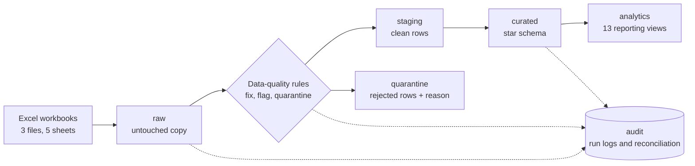

# Northstar FMCG - Sales & Inventory Pipeline

An end-to-end data engineering project: raw Excel files go through Python and SQL Server and come out as
a validated star schema and a set of reporting views. It is built the way a small data team would build it:
GitHub issues, feature branches, pull requests, written decision records and automated tests.

## The problem

Northstar Consumer Goods records sales, product stock and stock movements in spreadsheets. The numbers
can't be trusted until the data has been profiled, cleaned with clear rules, reconciled, and modelled for
reporting. The goal is to answer the business questions in
[`documentation/02_Business_Questions.md`](documentation/02_Business_Questions.md) with figures that
reconcile to the source.

## Architecture



| Layer | Purpose |
|---|---|
| `raw` | Exact copy of the source sheets. Never changed. |
| `staging` | Rows that passed the data-quality rules, correctly typed. |
| `quarantine` | Rows held back, stored with their original values and a reason code. |
| `curated` | Star schema: 3 fact tables and 6 dimensions. |
| `analytics` | 13 views that answer the business questions. |
| `audit` | Every run, every row count and every rule result. |

## Data

| Workbook | Sheets | Rows |
|---|---|---|
| `01_sales_transactions.xlsx` | Sales transactions, customer master | 65,000 and 500 |
| `02_product_inventory.xlsx` | Product master, inventory snapshot | 30 and 120 |
| `03_inventory_movements.xlsx` | Inventory movements | 15,000 |

## Data-quality approach

Profiling found reused transaction IDs, sales with no customer, sales for an unknown product, discounts
above 100%, negative quantities on orders that are not returns, and inconsistent labels. Each rule has one of
three outcomes. Nothing is silently deleted.

| Outcome | Meaning | Example |
|---|---|---|
| **Fix** | Correct it automatically | `" online "` becomes `Online` |
| **Flag** | Keep the row and mark the problem | Reused transaction IDs (80 IDs, 160 rows) |
| **Quarantine** | Hold the row back with a reason code | Unknown product, discount above 100% |

Sales with no customer are kept and linked to an `UNKNOWN` customer, so revenue stays complete.

| Table | Raw rows | Clean | Quarantined |
|---|---|---|---|
| Sales transactions | 65,000 | 64,233 | 767 |
| Inventory snapshot | 120 | 115 | 5 |
| Inventory movements | 15,000 | 14,970 | 30 |

Net sales reconcile exactly between staging and the curated model. The full rule list is in
[`documentation/adr/001-business-rules.md`](documentation/adr/001-business-rules.md).

## Data model

Three fact tables (sales, inventory snapshot, inventory movement) share the date, product and warehouse
dimensions. The sales fact also uses customer, sales channel and order status. The design decisions and the
diagram are in [`documentation/adr/002-star-schema.md`](documentation/adr/002-star-schema.md).

**Business definitions:** revenue is Delivered orders only. Returned value is shown beside revenue as a
positive amount. Pending orders are open orders and Cancelled orders are lost sales. Neither is revenue.

## Sample findings

- Deeper discounts did not buy bigger orders. Units per order stay around 4.1 to 4.3 in every discount
  band, while average order value falls from about ₦13,091 with no discount to ₦10,745 at 15% and above.
- Revenue is not concentrated. The top 10% of customers bring 16.4% of it.
- 12 of 115 product and warehouse lines are below reorder level.
- 12 lines imply negative opening stock, so stock movements and the snapshot do not fully reconcile.

## Tech stack

Python (pandas, SQLAlchemy, pyodbc, PyYAML), SQL Server, pytest, Git and GitHub, VS Code.

## Getting started

**Prerequisites:** Python 3.10 or newer, SQL Server (Express or Developer edition), and the Microsoft ODBC
Driver 17 or 18 for SQL Server.

1. Copy the settings: edit `config/config.yaml` with your server name and driver, and keep the
   `reference: valid_warehouses` list.
2. Run the setup and the pipeline:

```powershell
# one-time setup
python -m venv .venv
.venv\Scripts\Activate.ps1
pip install -r requirements.txt

# create the database objects: run each script in SQL Server, in this order
#   sql/01_create_database_and_schemas.sql
#   sql/02_create_raw_and_audit_tables.sql
#   sql/03_create_staging_and_quarantine_tables.sql
#   sql/04_create_curated_model.sql

# run the whole pipeline (load, data quality, curated model, views, validation)
python src/run_pipeline.py

# run the tests
pytest

# create the reporting views (sql/06_create_analytics_views.sql), then check everything
python src/validate_views.py
pytest
```

Every step can be re-run safely. Each one empties and reloads its own tables, inside a single transaction.
`sql/05_load_curated.sql` is run by `build_curated.py`.

## Testing and validation

- `pytest` runs 31 tests: 25 for the data-quality rules and 6 for the date dimension.
- `python src/validate_views.py` recalculates the key numbers of every view independently in pandas and
  compares them with the views (18 checks).
- `sql/checks/` holds reconciliation queries for the raw, data-quality, curated and view layers.

## Orchestration with Airflow (optional, local)

`orchestration/dags/northstar_fmcg_pipeline.py` is an Airflow DAG with five tasks that run in order:
load raw, data quality, build curated model, create views, validate views.

Airflow runs in WSL2 and starts the project's Windows Python, which keeps the SQL Server Windows
sign-in simple. This is a local development setup. A production setup would use containers and
securely stored credentials.

## Repository structure

```
config/          settings (server, driver, warehouse list)
data/            the three source workbooks
documentation/   business brief, data dictionary, roadmap, profiling findings,
                 analytics views guide and decision records (adr/)
sql/             numbered setup scripts, reporting views and checks/
src/             profiling, loading, data-quality rules, model build, validation
tests/           automated tests
```

## Documentation

| Document | What it covers |
|---|---|
| `documentation/01_Business_Problem_and_Scope.md` | The business problem and scope |
| `documentation/02_Business_Questions.md` | The questions the project answers |
| `documentation/03_Data_Dictionary.md` | Every source column |
| `documentation/04_Implementation_Roadmap.md` | The phased plan |
| `documentation/06_Profiling_Findings.md` | What profiling found |
| `documentation/07_Analytics_Views.md` | Which view answers which question |
| `documentation/adr/` | Decision records for the rules and the model |

## Status and next steps

- [x] Profiling, raw load, data-quality rules, star schema, analytics views, validation
- [x] Automated tests for missing or malformed input files
- [x] One-command pipeline run
- [x] Optional extensions: orchestration (Airflow) and a PySpark comparison

## Notes

The dataset and business brief are synthetic. 

## Blavklyst
