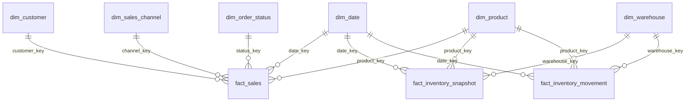

# ADR 002: Star schema for the curated layer

- **Status:** Accepted
- **Date:** 2026-11-07

## Context

The staging tables hold clean, validated rows, but they are shaped like the source files.
Reporting (Power BI) needs a model that is easy to filter, slice and total. This ADR records how
the `curated` layer is shaped and why.

## Model

Facts are the events, dimensions describe them. Three facts share the same dimensions
(date, product, warehouse), so sales and stock can be analysed together.

| Table | One row is... |
|---|---|
| `fact_sales` | one accepted sales transaction line |
| `fact_inventory_snapshot` | one product in one warehouse on the snapshot date |
| `fact_inventory_movement` | one stock movement event |
| `dim_date` | one calendar day |
| `dim_customer`, `dim_product`, `dim_warehouse` | one customer / product / warehouse |
| `dim_sales_channel`, `dim_order_status` | one channel / one order status |

## Decisions

1. **Surrogate keys.** Every dimension has its own small integer key (`customer_key` and so on),
   and the business ID (`customer_id`) is kept as a unique column. Facts point at the surrogate key.
2. **An "unknown" customer.** Sales with no customer (flagged in ADR 001) join to `customer_key = -1`,
   named `Unknown customer`. The sale stays in the totals and appears under "Unknown" in reports.
3. **Reused IDs stay allowed.** `transaction_id` and `movement_id` are not unique in the source, so
   facts have their own primary key (`sales_key`, `movement_key`) and keep the ID as a plain column
   with its flag.
4. **Order status groups.** `dim_order_status` maps Delivered to Completed (counts as revenue),
   Returned to Returned, Pending to Open and Cancelled to Cancelled. Only Completed counts as revenue.
5. **Reorder rule.** `is_below_reorder` is true when `available_units` is below `reorder_level_units`.
   Available stock is used because reserved stock cannot be sold.
6. **Date dimension.** Generated by script (`calendar_dim.py`) for whole calendar years covering
   every date in the data, which is 2025 (365 days).
7. **Small dimensions for channel and status** let Power BI slice by them and let the status rules
   live in one place.
8. **Full rebuild on every run.** Curated tables are emptied and rebuilt from staging in one
   transaction, then checked: row counts match staging, net sales match to the cent, and the sales
   linked to the unknown customer equal the flagged rows.

## Open questions

- **Returns and the sign of values.** Of the 16,125 raw Returned orders, 15,945 have positive
  quantities and values, and 180 have negative ones. The model keeps values exactly as recorded, so
  the reported "returned value" needs a decision before the Power BI measures are written: report
  returns as a positive amount shown beside revenue, or subtract them from revenue.
- **Even status split.** In this synthetic data the four statuses are nearly equal in size (about a
  quarter of rows each), so Completed sales are only about a quarter of total net sales. That
  is a property of the data, not a bug.

## Consequences

- Power BI can use the model with simple one-to-many relationships.
- Changing a business definition (revenue, reorder rule) means editing one SQL statement and
  rebuilding.
- Keys are assigned by sort order, so they stay stable as long as the data does not change.
